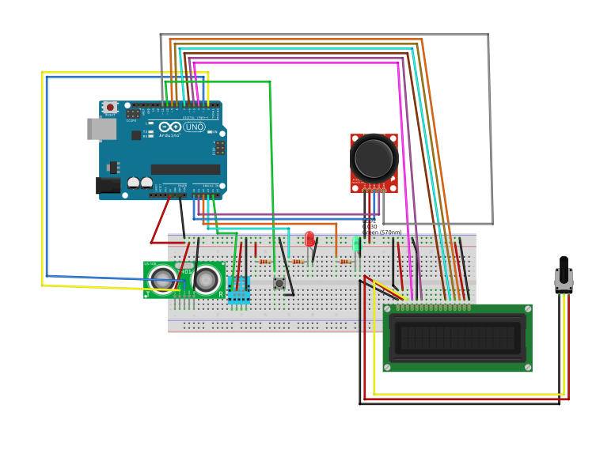
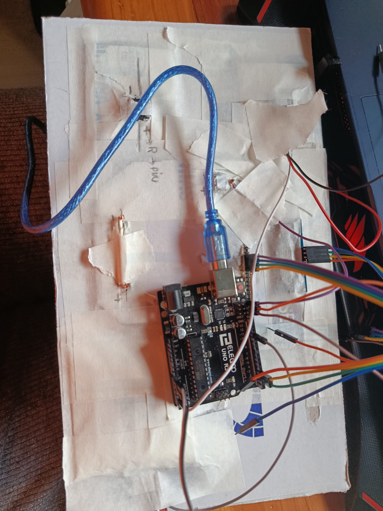
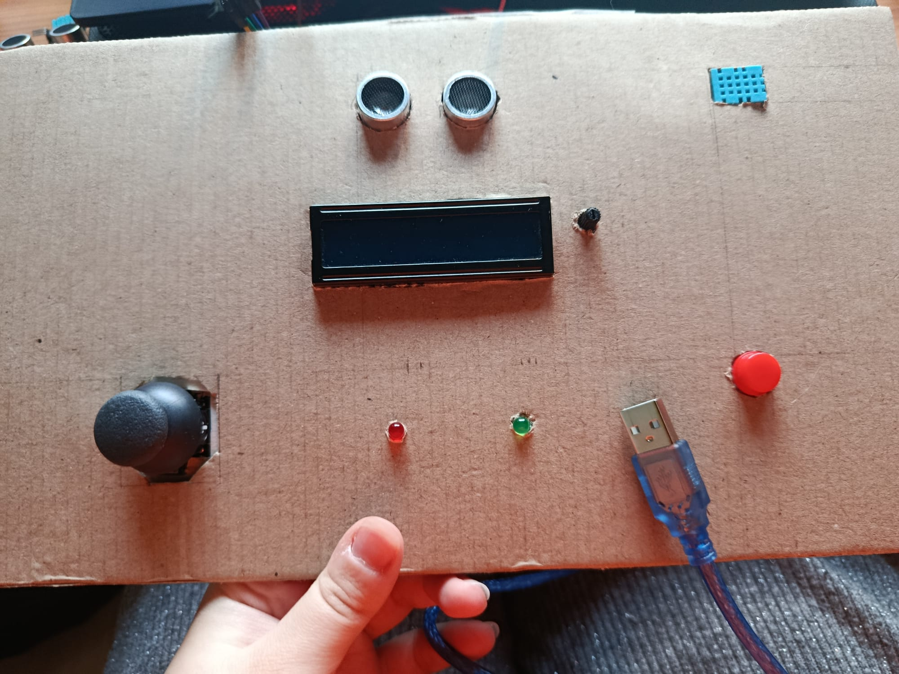
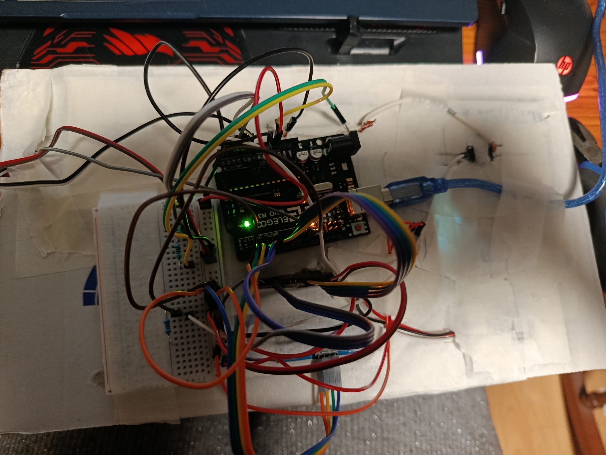
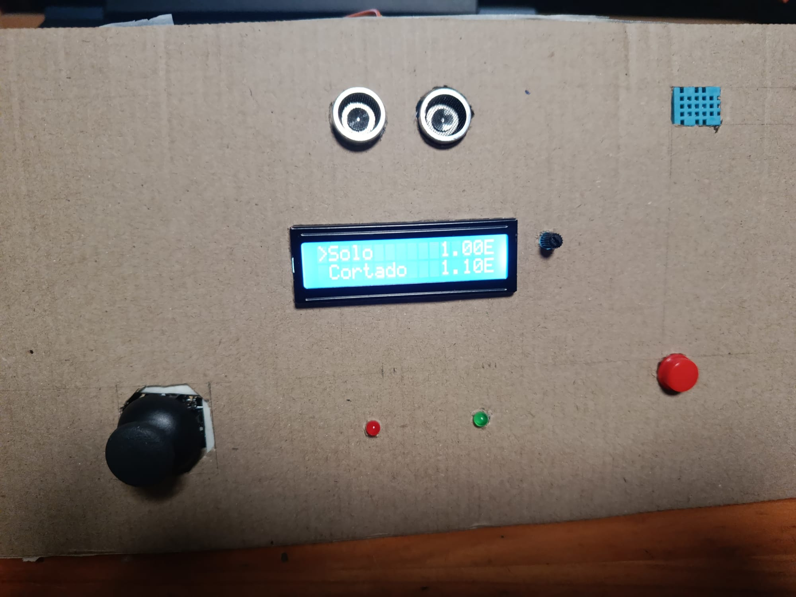

# Practica 3 de la asignatura de Sistemas Empotrados y Tiempo Real de 3 año de la carrera de Ingenieria de Robotica Software
##  Introducción 
Para este proyecto vamos ha hacer uso de una placa Elegoo y diferentes componentes. De componentes usaremos una pantalla LCD, un joystick, un sensor de temperatura y humedad, un sensor de ultra sonidos, un pulsador y dos LEDs.

El proyecto consiste en crear una especie de simulación de maquina expendedora, donde en un modo inicial estara en modo servicio y permitira al usuario navegar atraves de una interfaz y seleccionar el tipo de bebida que necesite. Si se presiona durante dos o tres segundos el boton la maquina se reiniciara, y en caso de que el tiempo presionando al boton sea 5 segundos la maquina entrara en modo administrador. En modo administrador podremos navegar por un menu especial para verificar estados de los sensores y modificar los precios de las bebidas.

## Funcionamiento
Para ello se crearon diferentes archivos para tener el proyecto mucho más ordenado como archivos .h y .cpp para evitar tener un main de demasiadas lineas y asi ayudar a la busqueda de errores y para facilitar la modificacion del código en el futuro. Además en este archivo creo los hilos para el funcionamiento de todos los componentes, teniendo como resultado hilos para el controlador, la pantalla, el sensor de humedad, el sensor de ultrasonido, el joystick.\
\
En este caso he creado una libreria llamada `library.h`, tres archivos .cpp que serian: `admin.cpp`, `service.cpp`y `start.cpp`. Y finalmente un main para la placa llamada `main.ino`.\
\
En el archivo `library.h` defino las funciones y que he usado a lo largo de los otros archivos, además de las enumeraciones con los estados que usare posteriormente en el código o las posiciones del propio joystick, y ademas incluyo todas las variables globales necesarias para cada archivo del proyecto.\
\
En el archivo `admin.cpp` tengo el bucle principal de este servicio y además tengo las funciones para mostrar el menu del administrador, una funcion para el cambio a modo admin y otra para salir de él. En el bucle principalmente esta el menu y las selecciones de las opciones tales como mirar la temperatura, la distancia, el tiempo desde el inicio o reinicio de la maquina y la modificación de los precios de los productos.\
\
En el archivo `service.cpp` inclye el bucle principal de este servicio, que incluye el menu, la muestra de la temperatura y la humedad, gestiona la seleción de la bebida, la preparación y la retirada; y una interfaz de usuario para la preparacion de la bebida y la retirada de esta.\
\
En el archivo `start.cpp` defino los objetos y defino variables globales para todos los componentes

## Montaje

Primero antes de empezar con el enunciado y ponerme con el código directamente primero miro los componentes que debo de usar y estudio un poco su uso. Por ejemplo para el _joystick_ era necesario entender el posicionamiento y el funcionamiento con las cordenadas. Despuś de un poco de busqueda, logre hacer la conexión e indagando un poco más con videos entiendo el funcionamiento básico del componente.\
Como previamente y en otras asignaturas y de forma autodidactuca ya habia usado otro tipo de componenetes como la **pantalla LCD** e incluso el sensor **DH11** no necesito indagar mucho. Sin embargo, algo nuevo que si he podido y me ha tocado investigar era el uso de librerias externas junto con su instalación.\
Una vez probado todos los componenten en individual, voy haciendo una idea del como se desarrollaria la practica. Por ejemplo, empiezo con cosas más basicas como el parpadeo del **LED** junto con el mensaje en la **Pantalla LCD**. Luego continuo añadiendo componentes como el **Ultrasonido**, denuevo jugando con el funcionamiento base, mostrando el mensaje de "esperando cliente" y ha cierta distancia que se muestre "bienvenido". Después inclui el sensor **DH11** y en vez de que la **LCD** mostrara "bienvenido" hacia un display de la temperatura y de la humedad. Antes de pasar con la interfaz y con el **joystick** decidi implementar el **botón** y probar el estado de _reinicio_ y el _modo administrador_. Finalmente, pase a incluir el **joystick** y jugue con la interfaz que mostraba en la **LCD**.\
\
Lo más complicado he de decir que ha sido el uso de hilos. Ya que sin ellos el programa no respondia como se esperaba, por ejemplo si el proyecto se realizara con `delay` generaria conflictos con la **LCD** o incluso con los **LEDS** generando parpadeos, o con el **botón** y el **joystick** no se leian bien generando que no se pudiese mover por la interfaz o incluso que no se pudiera hacer el reinicio o el cambio a modo administrador.\
\
Para terminar el montaje entero, una vez probado todo y finalizado el código (el cual explico más abajo), paso a una etapa más creativa y menos electronica. Realizo un montaje con cajas de cartón donde voy a poner todos los sensores y actuadores para facilitar las interacciones del usuario y hacerlo más ligero y estetico a la vista.
>[!NOTE]
>El proceso del montaje en el carto esta puesto en las fotos más abajo, no subo fotos durante el recorte del cartón ya que considero que lo interesante en este proceso son las conexiónes por dentro de la caja.

## Funciones
### Inicio y Reinicio
Las funciones de este modo se encuentran el fichero `start.cpp`. En el definimos las variables globales y los sensores que vamos a utilizar, que equivaldria a la función `setup()` en los archivos _.ino_. Dentro de este archivo tengo funciones como:\
`resetSystem()`para el reinicio del sistema.\
`startBoot()` para el arranque.\
`enterIdle()` para la espera de un cliente.\
`drawEnv()` y `drawMenu()` para mostrar tanto el menu como la temperatura.\
`fmtProduct()` para darle el formato al producto cuando se muestre en pantalla.\
`setState()`que incia el tiempo.\
`measureDistance()` es la medición de distancia que se hace con el sensor **ultrasonido**.\
`lcdLine()` muestra la linea en el **LCD**.\
`readJoyButton()` para la lectura de **botón del joystick**.\
`readJoy()` para la lectura del **joystick**.\
`void isrTick()` es un controlador de interrupciones.\
\
`ISR(PCINT0_vect)` es un controlador propio del sistema y hago uso de él para determinar si se esta pulsado el boton o no.\
\
Dentro del propio código vemos unas lineas que son `PCICR |= (1 << PCIE0);` y `PCMSK0 |= (1 << PCINT2)`; Esto era necesario incluirlo ya que el botón lo tengo conectado el pin 10, y el pin 10 no tiene interrupciones entonces para evitar tener que mover el pin donde tengo otro modulo instalado y tampoco tener que estar mirando todo el rato el botón hago un cambio simulado de pin.

### Servicio
Las funciones de este modo se encuentran en el archivo `service.cpp`. Este archivo es bastante simple ya que se compone de dos funciones:\
`serviceLoop()` que contiene un _switch case_ que va cambiando dependiendo de en que estado nos encontremos. Tiene el estado `ST_BOOT` que al estar llamado en el archivo `start.cpp` nos lleva a el conectandolos y porcediendo a mostran en la **LCD** el mensaje de arranque y al parpadeo del **LED**. Al igual que en la primera parte del `switch` nos encontramos el caso del `ST_IDLE` (si entra en el rango de distancia pasa al siguiente y si no se queda esperando al cliente con el mensaje mostrandose en la **LCD**), `ST_ENV`(muestra la temperatura y la humedad), `ST_CATALOG`(Muestra los menús y permite realizar la selección, una vez hecha muestra preparando y pasa al siguiente estado), `ST_PREPARING`(Es gestionado en la UI en la otra función del archivo, pero sale la carga del producto y se ilumina el led prograsivamente) y `ST_RETIRE` (Muestra un mensaje y luego vuelve al inicio del bucle esperando otro cliente).\
`serviceUI()` se encarga de "preparar" la bebida (muestra eb pantalla el proceso con un porcentaje y gestiona el nivel de intensidad del LED), y luego de indicarnos que la bebida puede ser reitrada.

>[!NOTE]
>En los estados en los que solo sale break es porque son gestionados por otras partes del código, como `ST_PREPARING` lo gestiona la función `serviceUI()`.

### Administración
Las funciones de este modo se encuentran en el archivo `admin.cpp`. Se compone de las funciones:\
`fmtAdmin()` que al igual que la función `fmtProduct()` en el archivo `start.cpp` le da el formato al menu para el servicio de administrador.\

`enterAdmin()` cambia el modo, muestra el menú y enciende el **LED**.\

`exitAdmin()` cambia el modo _administrador_ al modo _servicio_.\

`adminLoop()` es el bucle principal compuesto con un _switch case_ donde siempre muestra el menu. Y dentro de ese primer _switch case_ tenemos otro _Switch case_ para la elección del menú, es decir para ver la temperatura si se escoge la opción de la temperatura, lo mismo con la de la distancia y el tiempo, y permite la modificación del precio de los productos (deja escoger que producto se quiere modificar el precio y cada subida/bajada se realiza de 10 centimos).
`adminUI()` muestra los datos en la **LCD** tales como la distancia, el tiempo y la temperatura, además del menú.

## Esquemas
Este es el esquema hecho con _Fritzing_.

## Fotos
Foto del inicio del montaje de la maquina. Todavia faltan cosas por conectar y verificar que funciona.

Vista delantera de lo que seria la maquina (todavia no terminada).

El hardware de la maquina ya terminado (ya se ha verificado que todo funciona correctamente).

Vista delantera una vez encendido y funcionando.

## Conclusión
A lo largo del proyecto uso diferentes recursos para intentar optimizar el funcionamiento de la maquina. Entre ellos las cosas que uso son:
    -**Threats**. Uso un total de 5 hilos para poder controlar diferentes funcionalidades del sistema, tales como: _parpadeo, joystick, distancia, DHT11 e interfaz_. He decidido hacer uso de los hilos ya que esto permitia darle diferentes periodos de ejecución a cada funcionalidad, ya que el joystick que se usaba para todos los menus no iba a tener la misma importacia y el mismo periodo que el sensor **DH11** que solo se ejecuta al inicio y en la interfaz de administrador si el usuario decide meterse en esa funcionalidad. Viendo que además de darles periodos personalizados, omito el uso de delays para evitar el fallo en los actuadores y para que los bucles no se queden pillados. Estan todos inicializados en el archivo `start.cpp`.
    -**Interrupciones**. Hago uso de ello porque si no, el botón para el reinicio y el cambio de modo no se podria utilizar ya que se quedaria en el bucle de la UI constantemente. Se usan en la función `handleButton()`en el archivo `start.cpp`.
    -**TimerOne**. Hago uso de esta funcionalidad para el apartado de tiempo del administrador, ya que cuenta los segundos en funcionamiento con precisión. Se usa en `initSystem`() en el archivo de `start.cpp` para inicializarlo. 
    -**Watchdog**. Hago uso de esta funcionalidad para gestionar que si en algun momento un bucle se queda pillado durante unos 4 segundos hace que se reinicie la placa sola automaticamente. Este funcionamiento lo incluyo en el loop del `main.ino` para el reinicio y en el `initSystem`() en el archivo de `start.cpp` para inicializarlo.